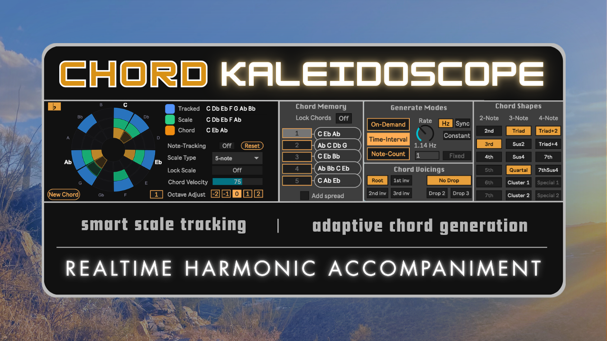
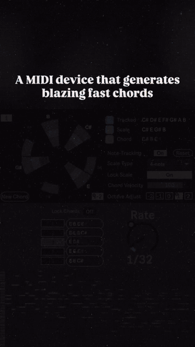
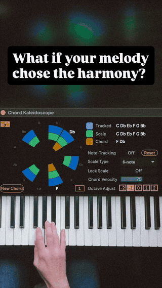
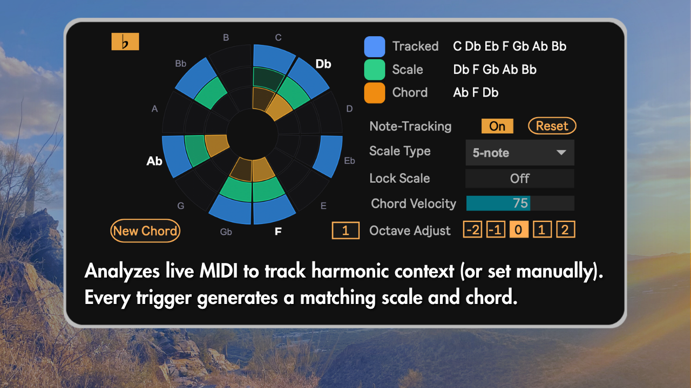
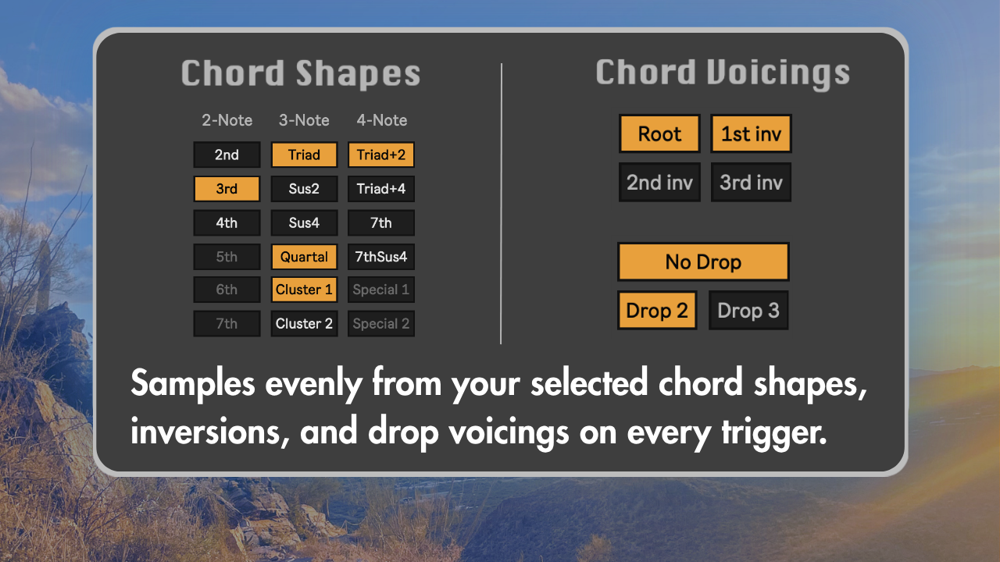
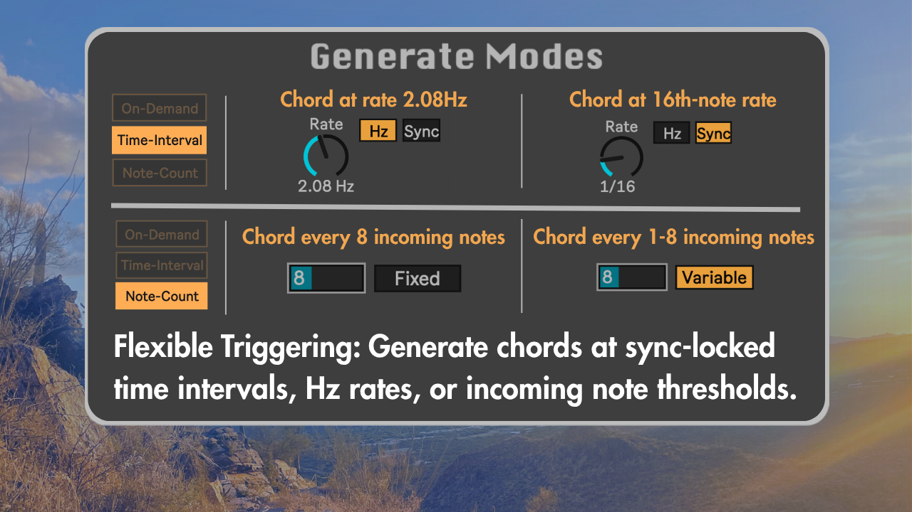
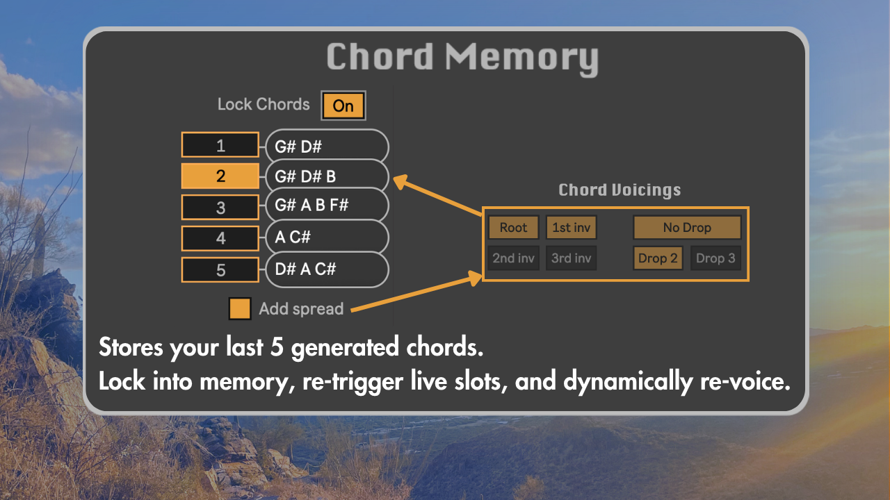

# Chord Kaleidoscope

**Generative harmony and real-time MIDI accompaniment for Ableton Live**

### Watch the Demo

*Click the thumbnail to watch the full demonstration on YouTube.*

Chord Kaleidoscope is an original Max for Live MIDI device that combines live scale tracking with adaptive chord generation. It listens to incoming MIDI notes, builds a harmonic context around them, and generates chords according to a configurable set of musical rules.

Designed for improvisation, composition, and experimental sound design, the device offers a way to explore harmonic possibilities without committing to a fixed key or chord progression.

**[Watch the Demonstration & Get the Device](https://hellojoywolf.gumroad.com/l/chord-kaleidoscope)** · **[User Manual](https://hellojoywolf.github.io/manual/)**

## Overview

Rather than generating chords from a predetermined progression, Chord Kaleidoscope responds to the notes you play.

Its harmonic engine maintains a collection of recently played pitch classes, identifies compatible scales, and generates chords using selected shapes, inversions, and voicings.

A three-ring graphical interface visualizes this process in real time:

- **Outer ring:** Notes tracked from live MIDI input or selected manually.
- **Middle ring:** The currently generated scale.
- **Inner ring:** The resulting chord.

This allows musicians to interact with the harmonic generation process visually while performing.

## Creative Applications

**Live accompaniment and improvisation**

Generate responsive harmonic accompaniment while playing a melody. Explore changing harmonic interpretations without manually programming every chord.

**Instant reharmonization**

Loop a melodic phrase and experiment with different scale types, chord shapes, voicings, inversions, and generation parameters.

**Generative sound design**

Use rapid chord generation to drive synthesizers and effects. Free-running generation supports rates up to 20 Hz, enabling dense textures and experimental rhythmic material.

## Features

### Adaptive Scale Tracking

Chord Kaleidoscope tracks incoming MIDI pitch classes to construct a harmonic context. Compatible scales are selected from a predefined collection, with scale sizes ranging from four to eight notes.

The harmonic context can also be edited directly through the graphical interface.

### Three Generation Modes

| Mode | Behavior |
|---|---|
| **Manual** | Generate a new chord on demand. |
| **Time-Interval** | Generate chords continuously or reactively, synchronized to Ableton's tempo or using a free-running interval. |
| **Note-Count** | Trigger chord generation after a fixed or variable number of incoming MIDI notes. |

### Chord Shapes and Voicings

Configure the harmonic structures available to the generator, including intervals, triads, suspended chords, quartal structures, clusters, and seventh-chord variations.

Select inversions and drop voicings to create different harmonic textures. The generator samples from enabled options rather than relying on a single fixed chord shape.

### Five-Slot Chord Memory

Store the five most recently generated chords, lock the memory, recall individual chords, and apply new voicings to previously generated material.

### Global MIDI Controls

- Octave transposition from −2 to +2 octaves
- Single- or dual-octave spreading
- Chord velocity control
- Scale locking and manual harmonic-context editing

For detailed controls, examples, and setup instructions, see the **[complete user manual](https://hellojoywolf.github.io/manual/)**.

## Technical Implementation

Chord Kaleidoscope was developed in **Max for Live**, combining Max's MIDI processing and event-driven patching environment with custom JavaScript modules.

The source repository contains components responsible for MIDI routing, harmonic-context management, scale and chord selection, chord transformations, generation timing, memory, and graphical interaction.

### Harmonic Representation

Pitch classes are represented numerically within the 12-note chromatic system.

The scale-selection system uses a precomputed collection of eligible pitch-class sets. These sets follow a constraint excluding three consecutive chromatic semitones, including across the octave boundary.

Incoming notes update the tracked harmonic context. The generator can then select compatible scale material according to the active rules and requested scale size.

### Chord Generation

The generation pipeline combines several configurable operations:

1. Maintain the current harmonic context from incoming or manually selected notes.
2. Identify compatible scale material.
3. Select enabled chord shapes and voicing parameters.
4. Construct and transform the generated chord.
5. Route the resulting MIDI notes to Ableton Live.
6. Update the visual display and chord history.

### Interface and State

The graphical interface presents tracked notes, scale notes, and generated chord tones on a circular pitch-class display.

Additional JavaScript modules manage interface options, generated chord history, parameter selection, and synchronization with the generation engine.

### Source Code

The repository includes:

| Component | Description |
|---|---|
| [`Chord Kaleidoscope.amxd`](Chord%20Kaleidoscope.amxd) | Max for Live device |
| [`code/`](code/) | JavaScript modules for generation, routing, timing, state, and voicing |
| [`data/`](data/) | Harmonic lookup data and parameter configurations |
| [`jsui_kaleidoscope.js`](jsui_kaleidoscope.js) | JavaScript graphical interface |

Selected implementation files include [`create_chord.js`](code/create_chord.js), [`voice_leading.js`](code/voice_leading.js), [`chord_memory.js`](code/chord_memory.js), and [`midi_router.js`](code/midi_router.js).

## Compatibility and Documentation

**Release:** Chord Kaleidoscope 1.0

**Host:** Ableton Live 11 or 12 with Max for Live

**Installation and usage:** See the [user manual](https://hellojoywolf.github.io/manual/) for setup instructions, device controls, and example workflows.

The commercially distributed version, demonstration, and additional product information are available on [Gumroad](https://hellojoywolf.gumroad.com/l/chord-kaleidoscope).

## About the Project

Chord Kaleidoscope is an independently developed music software project by **Christopher Alagna**, a pianist, composer, and software developer with a background in jazz, improvisation, and experimental music.

The project grew from an interest in creating a more exploratory relationship between musical performance and generative computation.

Its central goal is not to replace musical decision-making, but to provide a responsive environment for discovering unexpected harmonic possibilities.

## Links

- **[Product Page & Video Demonstration](https://hellojoywolf.gumroad.com/l/chord-kaleidoscope)**
- **[Complete User Manual](https://hellojoywolf.github.io/manual/)**
- **[GitHub Repository](https://github.com/christopheralagna/Chord-Kaleidoscope)**

**Contact:** hellojoywolf@gmail.com
